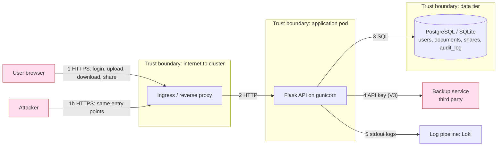

# DocVault threat model (STRIDE)

Method: we model the system as a data-flow diagram (DFD), mark the trust boundaries, then apply the six STRIDE
categories to every element that crosses a boundary. Each threat gets a risk rating, the control that exists today,
and the OWASP Top 10:2025 category. The five planted flaws (V1-V5, see `vulnerabilities.md`) are linked to the
threats they realise, so the model explains *why* each fix matters.

STRIDE = **S**poofing, **T**ampering, **R**epudiation, **I**nformation disclosure, **D**enial of service,
**E**levation of privilege.

## 1. System and assets

DocVault lets users upload documents, keep them encrypted at rest, and share them with other users. Admins manage
accounts and read the audit log.

| Asset | Why it matters | Where it lives |
|---|---|---|
| Document contents | Confidentiality is the product | Encrypted (Fernet) in the database |
| Credentials and tokens | Gives access to everything a user owns | Argon2 hashes in DB; JWT (ES256) in the browser |
| Signing and encryption keys | Compromise defeats all other controls | Key files and secrets (`JWT_SECRET`, `FERNET_KEY`) |
| Audit log | Evidence for detection and response | `audit_log` table |
| Backup service key | Access to off-site copies | `integrations.py` (V3) |

## 2. Data-flow diagram and trust boundaries

Entry points an attacker can reach without credentials: `/api/auth/register`, `/api/auth/login`, `/api/health`,
`/api/public-key`, `/.well-known/jwks.json`, and the static dashboard. Everything under `/api/documents`,
`/api/users` and `/api/admin` needs a valid token; `/api/admin` additionally needs the `admin` role.

**Assumptions.** TLS is terminated at the ingress. The attacker is an internet user who can register an account (so
"authenticated user" is not a trusted party). Inside the cluster the pod network is hostile until a NetworkPolicy
says otherwise. The host and the Kubernetes control plane are out of scope.

## 3. Threats by STRIDE category

Risk = likelihood x impact on a High / Medium / Low scale. "Today" is what exists in the code now (V1-V5 present).

| ID | Cat. | Element | Threat | Risk | Control today | OWASP 2025 | Flaw |
|---|---|---|---|---|---|---|---|
| T1 | S | Login | Credential stuffing and password guessing against `/login` | High | Argon2 hashes, lockout after 5 failures per account, audit event. **No rate limiting is active**: the limiter is initialised but no route uses it (`default_limits=[]`), so an attacker can spray one password across many accounts without being slowed | A07 | - |
| T2 | S | Tokens | Stolen or forged JWT used to impersonate a user | Medium | ES256 signature, required `exp`/`iat`/`sub`/`jti`, revocation list, refresh rotation | A07 | - |
| T3 | S | Backup channel | Attacker who reads the repo authenticates to the backup service as DocVault | High | None: key is in source and git history | A07 (CWE-798) | **V3** |
| T4 | T | Search endpoint | SQL injection rewrites or reads any table (e.g. `UNION SELECT` of `users`) | High | None on this route (bound parameter on others) | A05 | **V1** |
| T5 | T | Documents at rest | Modification of stored files by someone with DB access | Medium | Fernet authenticated encryption detects tampering on decrypt | A04 | - |
| T6 | T | Dependencies / image | A malicious or vulnerable package changes behaviour (supply chain) | High | None: gunicorn 21.2.0 with known request-smuggling CVEs | A03 | **V4** |
| T7 | R | Admin actions, downloads | A user or admin denies an action (role change, download of a document) | Medium | Audit log covers auth and admin actions. Document downloads and uploads are **not** logged. The log lives in the same database, so V1 can edit it | A09 | V1 |
| T8 | I | Download endpoint | Any logged-in user reads any other user's document by changing the id (IDOR) | High | None on this route (owner/share check removed) | A01 | **V2** |
| T9 | I | Error responses | Stack traces, file paths, SQL errors and the Werkzeug debugger leak internals | Medium | None: debug on by default | A02 | **V5** |
| T10 | I | Search endpoint | UNION injection exposes `password_hash` of all users | High | None (same root cause as T4) | A05, A04 | **V1** |
| T11 | I | Repo and image layers | Secrets read from git history, CI logs or image layers | High | `.gitignore` for keys; nothing prevents committed secrets yet | A07 | **V3** |
| T12 | D | Upload endpoint | Large or many uploads exhaust memory, disk or the database | Medium | 2 MB request cap, 1 MB file cap, extension allow-list | A06 | - |
| T13 | D | Login / register | Flooding the API or locking out victims on purpose (lockout is a DoS lever) | Medium | None for request volume (see T1). Lockout is itself a lever: an attacker can lock a victim out by failing 5 logins. Admin unlock exists | A06 | - |
| T14 | D | Pod / cluster | One compromised pod floods or scans the cluster network | Medium | None yet (planned: resource limits, default-deny NetworkPolicy) | A02 | - |
| T15 | E | Role change / admin API | A normal user reaches `/api/admin` or sets their own role | High | `admin_required` decorator, role stored server-side | A01 | - |
| T16 | E | Container | Code execution in the app gives root in the container, then node escape | High | Not hardened yet (planned: non-root, read-only filesystem, dropped capabilities) | A02 | - |
| T17 | E | Werkzeug debugger | With debug on, the console PIN is the only barrier to running Python on the server | High | None (V5) | A02 | **V5** |

## 4. How the flaws and threats connect (attack chain)

The planted flaws are not independent. A realistic chain an assessor should be able to follow:

1. **V5** shows the exact SQL and file paths when the search box gets a quote.
2. **V1** then lets the attacker `UNION SELECT` usernames and password hashes (T4, T10) and edit the audit log (T7).
3. **V2** lets any registered account read other users' documents without any injection (T8).
4. **V3** and **V4** are the supply-chain side: the leaked backup key (T3, T11) and an outdated server (T6) are
   found by scanners long before a human notices.

This is why the plan fixes them in layers: code fixes (V1, V2, V5), secrets handling (V3), dependency policy (V4),
and platform controls that limit damage if a code flaw slips through (container, Kubernetes, monitoring).

## 5. Mitigations and where they are delivered

| Threat(s) | Mitigation | Delivered in |
|---|---|---|
| T4, T10 | Parameterised query on search; Semgrep rule blocks string-built SQL | Remediation + CI (SAST) |
| T8 | Restore owner/share check in download (`_load_accessible`) | Remediation + authenticated ZAP test |
| T3, T11 | Secret from environment/secret store; Gitleaks in CI; revoke first, purge after | Secrets step + CI |
| T6 | Upgrade gunicorn >= 22.0.0; pip-audit and Trivy block High with a fix and all Critical | CI (dependency and image scan) |
| T9, T17 | Generic error plus correlation id; debug off by default; remove `debug=True` | Remediation + ZAP |
| T7 | Log document access; ship logs to Loki, outside the application database | Observability |
| T1, T13 | Enable real rate limits (per-IP and per-username) on `/login` and `/register` with a shared store (Redis) or at the ingress; alert on login-failure spikes | Hardening + observability |
| T12, T14 | Resource requests/limits, default-deny NetworkPolicy | Kubernetes step |
| T16 | Multi-stage build, non-root user, `readOnlyRootFilesystem`, drop all capabilities, Kyverno admission rules | Container + Kubernetes steps |
| T5, T2, T15 | Already present; covered by existing tests, kept as regression checks | Tests |

## 6. Residual risk and limits of this model

- STRIDE is applied per element, so it can miss abuse of legitimate features (for example using document sharing to
  send unwanted files). Business-logic abuse is only partly covered.
- The model assumes TLS at the ingress; we do not model a compromised cluster node or the CI provider itself.
- Ratings are qualitative judgments by the team, not measured probabilities. They guide ordering of work, not
  budgets.
- After the fixes, remaining risks we accept and monitor: rate limiting only as strong as the ingress/shared store we add
  (T1, T13), no malware scanning of uploads, and no multi-factor authentication.
